# Sprawozdanie projektu Zaliczone

**Zespół:** Szymon Przybysz, Iwona Figas, Jarek Antczak, Emil Kosicki.

Wersja składu zgodna z wzorcem UKW znajduje się w output/docx/Sprawozdanie-Zaliczone.docx i output/pdf/Sprawozdanie-Zaliczone.pdf. Notatki i feedback stanowią symulację dydaktyczną.

## 1. Wprowadzenie

### Cel projektu

Zaliczone jest planerem nauki i zaliczeń dla studentów. Łączy przedmioty, daty egzaminów, kolokwiów i projektów oraz zadania przygotowawcze. Zamiast odtwarzać plan z wiadomości i luźnych notatek, użytkownik otrzymuje jeden przegląd semestru. Celem użytkowym jest szybkie ustalenie najbliższego kroku i czasu pozostałego do zaliczenia.

### Zakres projektu i metodyka pracy

MVP obejmuje dodawanie i usuwanie przedmiotów, terminy, zadania, filtrowanie, postęp oraz kopię JSON. Dane są lokalne; produkt nie wymaga konta. Pracę planujemy w Scrumie z tablicą Kanban, w dwóch tygodniowych sprintach. Krótki cykl pozwala najpierw dostarczyć rdzeń planera, a następnie dopracować ochronę danych i wygodę obsługi.

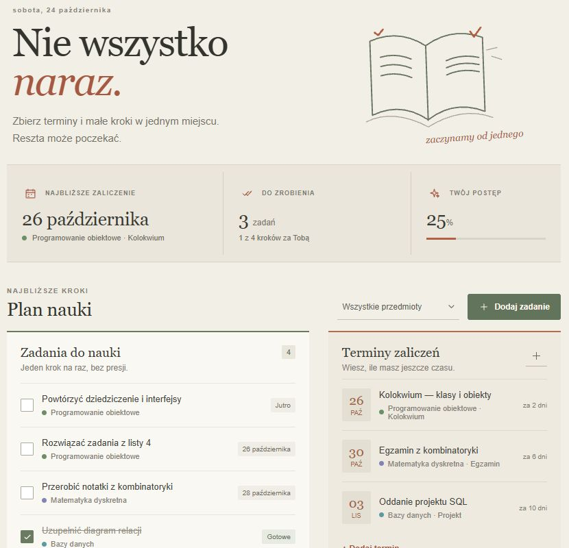
Rys. 1. Widok planera z przykładowymi przedmiotami, zadaniami i terminami

## 2. Organizacja zespołu projektowego

### Role w projekcie i podział odpowiedzialności

Zespół liczy cztery osoby. Rozdział ról porządkuje decyzje, ale nie wyklucza pomocy przy implementacji i przeglądzie. Iwona ustala wartość i kolejność funkcji, Jarek dba o przebieg sprintu, Szymon o spójność techniczną, a Emil o mierzalny odbiór. Każdy element backlogu ma jednego właściciela odpowiedzialnego za doprowadzenie go do odbioru.

| Osoba | Rola | Odpowiedzialność |
| --- | --- | --- |
| Szymon Przybysz | Deweloper i koordynator techniczny | Model danych, kopie JSON, repozytorium, CI i publikacja Pages |
| Iwona Figas | Product Owner i analityk UX | User Stories, priorytety, formularze, wygląd i instrukcja użytkownika |
| Jarek Antczak | Scrum Master i deweloper | Przepływ zadań, terminy, filtr, harmonogram i raporty sprintów |
| Emil Kosicki | Tester i deweloper | Scenariusze testowe, walidacja, dostępność, rejestr błędów i checklista |

### Plan komunikacji

| Spotkanie | Częstotliwość | Rezultat |
| --- | --- | --- |
| Planowanie sprintu | Początek iteracji, 45 minut | Cel, zakres, estymaty i zależności |
| Daily Scrum | Dni robocze, 10 minut | Co zrobiono, następny krok, blokada |
| Przegląd sprintu | Koniec iteracji, 30 minut | Demonstracja przyrostu i decyzja o odbiorze |
| Retrospektywa 4Ls | Po przeglądzie, 25 minut | Jedno lub dwa działania na kolejną iterację |

GitHub Issues przechowuje ustalenia i kryteria odbioru, Projects pokazuje bieżący przepływ, a Pull Request łączy zmianę z jej przeglądem. Pilną blokadę zgłaszamy od razu i dopisujemy ją do zadania. Skrócone notatki spotkań oraz wypowiedzi wszystkich osób znajdują się w rozdziale dziewiątym.

## 3. Planowanie i szacowanie pracy

### Backlog Produktu i priorytety

Backlog opisuje wartość dla studenta. Każdą pozycję rozwijamy do zdania: Jako student chcę wykonać daną czynność, aby uporządkować naukę i zaliczenia. P0 oznacza funkcję konieczną dla MVP, P1 usprawnienie potrzebne w gotowym wydaniu. Punkty porównują złożoność i ryzyko, a nie czas pracy konkretnej osoby.

| ID | Potrzeba użytkownika | Pr. | SP | Właściciel | Sprint |
| --- | --- | --- | --- | --- | --- |
| US-01 | Dodać przedmiot i nadać mu kolor | P0 | 3 | Iwona | 1 |
| US-02 | Zapisać egzamin, kolokwium lub projekt | P0 | 5 | Jarek | 1 |
| US-03 | Rozbić przygotowanie na zadania | P0 | 5 | Iwona | 1 |
| US-04 | Oznaczać kroki i obserwować postęp | P0 | 3 | Emil | 1 |
| US-05 | Filtrować plan po przedmiocie | P1 | 3 | Jarek | 1 |
| US-06 | Zachować plan po ponownym otwarciu | P0 | 5 | Szymon | 1 |
| US-07 | Pobrać kopię planu do pliku JSON | P1 | 3 | Szymon | 2 |
| US-08 | Odtworzyć plan z poprawnej kopii | P1 | 5 | Szymon | 2 |
| US-09 | Widzieć najbliższy termin i liczbę dni | P0 | 3 | Jarek | 1 |
| US-10 | Poznać aplikację na danych przykładowych | P1 | 3 | Iwona | 2 |
| US-11 | Korzystać z planera na telefonie | P0 | 5 | Iwona | 2 |
| US-12 | Zrozumieć obsługę dzięki pomocy i FAQ | P1 | 3 | Emil | 2 |

### Kryteria akceptacji

Przedmiot musi mieć niepustą nazwę i kolor, a zadanie oraz termin muszą wskazywać istniejący przedmiot. Po zapisaniu wpis pojawia się w odpowiedniej liście. Oznaczenie zadania przelicza postęp. Filtr ogranicza widoczne zadania i terminy. Zapis przetrwa ponowne otwarcie strony, a błędny import nie zastąpi poprawnego planu.

Przykład US-08: mając własny plan i poprawną kopię JSON, po wyborze Przywróć kopię widzę potwierdzenie zastąpienia. Dopiero zatwierdzenie wczytuje dane. Anulowanie pozostawia poprzedni plan. Niepoprawna wersja, błędna relacja lub niemożliwa data wywołują komunikat i nie zmieniają danych.

### Techniki szacowania i plan sprintów

### Planning Poker

Stosujemy skalę 1, 2, 3, 5 i 8 SP. Iwona wyjaśnia potrzebę oraz kryteria, każdy proponuje ocenę, a osoby z najniższą i najwyższą wartością uzasadniają rozbieżności. Po doprecyzowaniu zakresu powtarzamy głosowanie. Element większy niż 8 SP dzielimy przed rozpoczęciem realizacji. Estymaty w tym sprawozdaniu są częścią scenariusza ćwiczenia.

| Element | Pierwsze oceny | Uzgodnienie i powód |
| --- | --- | --- |
| US-02 Terminy | 3, 5, 5, 5 | 5 SP: walidacja daty, relacja do przedmiotu i sortowanie |
| US-08 Import kopii | 3, 5, 8, 5 | 5 SP po odłożeniu łączenia dwóch planów; import zastępuje całość |
| US-11 Telefon | 3, 5, 5, 8 | 5 SP: jeden układ responsywny i kontrola klawiatury |

### Sprinty i cele iteracji

| Sprint | Cel | Zakres i pojemność |
| --- | --- | --- |
| 1 26.10–01.11.2026 | Plan ma strukturę i najbliższe kroki | US-01–06 oraz US-09; 27 SP. Przedmioty, zadania, terminy, filtr, postęp i lokalny zapis. |
| 2 02.11–08.11.2026 | Gotowy planer z kopią i wygodną obsługą | US-07, US-08, US-10–12; 19 SP. Import i eksport, demo, telefon, pomoc, testy i publikacja. |

### Definition of Ready i Definition of Done

Ready oznacza opis wartości, mierzalne kryteria, priorytet, właściciela, estymatę i rozwiązane zależności. Done oznacza spełnione kryteria, sprawdzenie adekwatne do zmiany, przegląd PR, zielone CI i aktualną dokumentację. Kod trafia do main wyłącznie przez PR. Zmiana terminu lub zakresu jest decyzją całego zespołu zapisaną w Issue.

Limit WIP wynosi cztery zadania w implementacji i dwa w odbiorze. Gdy limit jest osiągnięty, pomagamy domknąć rozpoczęte elementy. Nie rozpoczynamy kolejnej funkcji tylko po to, żeby każda osoba miała nowe zadanie. Synchronizacja kont, powiadomienia i integracja uczelniana pozostają poza MVP.

### Harmonogram Gantta i tablica pracy

Gantt pokazuje zależności i kamienie milowe dwóch iteracji. Nie zastępuje tablicy dziennej: po przeglądzie aktualizujemy zakres kolejnego sprintu. M1 oznacza demonstrację działającego rdzenia, a M2 końcowy odbiór planera, kopii danych i dokumentacji.

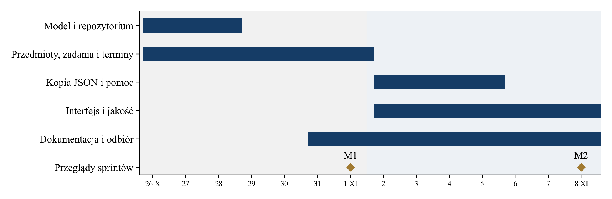
Rys. 2. Harmonogram dwóch sprintów i kamienie milowe M1 oraz M2

### Kanban i widok zespołu

Kanban ma kolumny Todo, In Progress i Done. Pole Etap pracy doprecyzowuje Backlog, Ready, implementację oraz Review/Test. Widok Zespół grupuje zadania według planowanego właściciela, dzięki czemu widać odpowiedzialność wszystkich czterech osób. Przypisanie kont GitHub jest odrębnym ustawieniem dostępu.

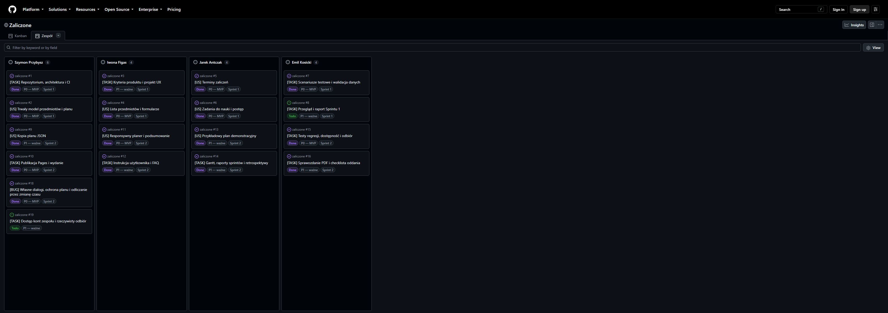
Rys. 3. GitHub Projects z czterema kolumnami odpowiedzialności zespołu

Podczas Daily Jarek sprawdza blokady i WIP, Iwona priorytety, Emil kolejkę odbioru, a Szymon zależności techniczne. Stan zadania zmieniamy po wykonaniu działania, a nie dopiero przed oddaniem projektu.

## 4. Dokumentacja techniczna

### Schemat logiczny aplikacji

Aplikacja działa w przeglądarce jako pojedynczy frontend. Formularz przekazuje dane do stanu PlannerData, z którego powstają listy, filtr i podsumowanie. Zmiana stanu jest zapisywana w localStorage. Import przechodzi walidację całego pliku przed zmianą planu; eksport zapisuje ten sam model do JSON.

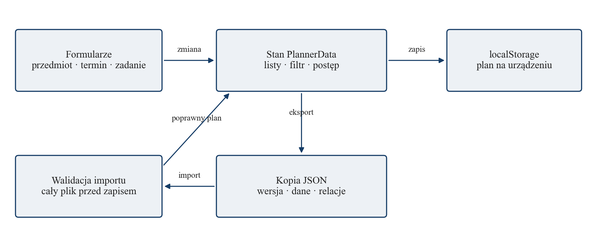
Rys. 4. Schemat logiczny przepływu danych w aplikacji

### Model danych i powiązania

| Encja | Pola | Reguła |
| --- | --- | --- |
| Subject | id, name, color | Unikalne id i niepusta nazwa przedmiotu |
| Exam | id, subjectId, title, date, type | Istniejący przedmiot; poprawna data; Egzamin, Kolokwium lub Projekt |
| StudyTask | id, subjectId, title, dueDate, done | Istniejący przedmiot; data; done jako wartość logiczna |
| PlannerData | version, subjects, exams, tasks | Wersja 1; identyfikatory i relacje sprawdzane przed odtworzeniem |

Relacja Subject do Exam i StudyTask ma postać jeden do wielu. Usunięcie przedmiotu po potwierdzeniu usuwa także jego terminy i zadania. Nie przechowujemy pól zależnych, takich jak procent postępu; wynik jest obliczany z aktualnej listy zadań. Zapobiega to rozjazdowi licznika i faktycznego planu.

### Schemat fizyczny i komponenty aplikacji

Kod źródłowy znajduje się w GitHub. Pull Request uruchamia testy i kompilację; po scaleniu workflow publikuje katalog dist w Pages. Przeglądarka pobiera statyczne pliki HTML, CSS i JavaScript. Dane planera nie trafiają do repozytorium ani hostingu. Plik JSON użytkownik przenosi samodzielnie.

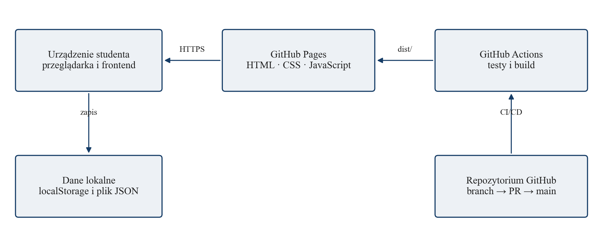
Rys. 5. Schemat fizyczny publikacji i lokalnego przechowywania planu

### Opis funkcji i komponentów

| Moduł | Odpowiedzialność |
| --- | --- |
| App.tsx | Stan aplikacji, dodawanie wpisów, filtr, podsumowanie i operacje na planie |
| TaskRow i ExamRow | Lista kroków, oznaczanie wykonania i czytelne daty zaliczeń |
| Modal i ConfirmDialog | Własne formularze i potwierdzenia; fokus, Tab, Escape i nieaktywne tło |
| types.ts | Typy domenowe, odczyt localStorage i walidacja kopii JSON |
| dates.ts | Porównywanie dat kalendarzowych niezależnie od zmiany czasu |
| Icons.tsx i styles.css | Własne SVG, kolory, typografia oraz reguły responsywnego układu |

Brak backendu ogranicza koszt utrzymania i liczbę zależności, ale nie zapewnia synchronizacji. Wyczyszczenie danych przeglądarki usuwa plan z urządzenia. Dlatego eksport jest stałą częścią interfejsu, a ostrzeżenie poprzedza czyszczenie, import i wczytanie przykładu na istniejącym planie.

## 5. Implementacja

### Lista zrealizowanych User Stories

| Przyrost | User Stories | Status | Rezultat i właściciel odbioru |
| --- | --- | --- | --- |
| Sprint 1 | US-01, US-03 | Gotowe | Formularze przedmiotów i zadań; Iwona |
| Sprint 1 | US-02, US-05, US-09 | Gotowe | Terminy, filtr i najbliższe zaliczenie; Jarek |
| Sprint 1 | US-04, US-06 | Gotowe | Postęp i zachowanie danych; Emil oraz Szymon |
| Sprint 2 | US-07, US-08 | Gotowe | Eksport i walidowane odtworzenie kopii; Szymon |
| Sprint 2 | US-10, US-11, US-12 | Gotowe | Przykład, telefon i pomoc; Iwona oraz Emil |

### Technologie użyte w projekcie

Frontend wykorzystuje React 18, TypeScript i Vite. Vitest oraz Testing Library sprawdzają logikę i zachowanie interfejsu, a GitHub Actions uruchamia npm ci, testy i build w Node.js 22. Projekt nie używa biblioteki komponentów ani ikon. Przyciski, formularze, okna i SVG zostały opracowane w kodzie aplikacji; fonty są dostępne lokalnie na urządzeniu.

### Problemy napotkane podczas implementacji

| Problem | Zastosowane rozwiązanie |
| --- | --- |
| Błędny import mógł zniszczyć plan | Walidacja całej kopii przed zapisem i potwierdzenie zastąpienia |
| Zmiana czasu zawyżała liczbę dni | Różnica dat kalendarzowych liczona względem północy UTC |
| Fokus opuszczał okno formularza | Wspólny Modal z Tab, Escape, inert i przywróceniem fokusu |
| Postęp i usuwanie znikały na telefonie | Widoczny wskaźnik i akcja kosza obok karty przedmiotu |
| Wygląd był zbyt podobny do gotowego szablonu | Własna typografia, papierowe tło, spokojne kolory i ilustracja SVG |

Najpierw domknęliśmy przepływ dodawania i przechowywania danych. Dopiero potem rozbudowaliśmy odbiór, potwierdzenia i mobilny układ. Dzięki temu poprawki wyglądu nie wymagały zmiany modelu planera.

### Branch i Pull Request jako droga do main

Każde zadanie rozpoczyna się na oddzielnym branchu feature/, fix/ lub docs/. Zmiany kodu i dokumentacji przechodzą ten sam proces. Właściciel opisuje rezultat w PR, łączy Issue, podaje sposób sprawdzenia i prosi o przegląd. Po poprawkach oraz zielonym CI stosujemy Squash and merge.

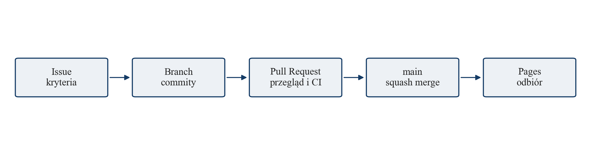
Rys. 6. Przepływ pracy od zadania przez branch i PR do publikacji

| Reguła | Znaczenie dla zespołu |
| --- | --- |
| PR wymagany do main | Każda zmiana ma osobną gałąź i miejsce na przegląd |
| Kontrola verify i aktualna gałąź | Testy i build muszą przejść dla kodu zgodnego z main |
| Rozwiązane uwagi | Otwarte rozmowy z przeglądu blokują scalanie |
| Ochrona administratora | Reguła obowiązuje także właściciela repozytorium |
| Historia liniowa | Squash utrzymuje czytelną historię rezultatów zadań |
| Zakaz force push i usunięcia main | Wspólna gałąź nie może zostać nadpisana ani skasowana |

### Lokalne zabezpieczenia i przegląd

Po sklonowaniu wykonujemy git config core.hooksPath .githooks. Hook pre-commit blokuje commit na main, a pre-push zatrzymuje wysyłanie do zdalnego main także z innej lokalnej gałęzi. Zabezpieczenie serwera nadal obowiązuje niezależnie od hooków. W zespole przyjmujemy przegląd przez inną osobę; techniczna konfiguracja nie narzuca obecnie minimalnej liczby akceptacji.

Iwona ocenia zgodność z potrzebą studenta, Emil scenariusze i regresje, Szymon model oraz publikację, a Jarek zależności i gotowość przyrostu. Uwagi odnoszą się do kryteriów zadania i kończą decyzją lub poprawką. Plik CONTRIBUTING.md opisuje komendy i pełny przebieg pracy.

## 6. Testowanie i jakość

### Rodzaje testów i dokumentacja testowa

Testy jednostkowe obejmują walidator i daty, integracyjne operacje interfejsu z magazynem, a systemowe działającą stronę i publikację. Odbiór akceptacyjny porównuje efekt z User Stories. Wynik automatyczny to 11 testów w czterech plikach. Przypadki użytkowe są liczniejsze niż pojedyncze testy, ponieważ jeden scenariusz może sprawdzać kilka powiązanych zachowań.

| ID | Przypadek | Oczekiwany wynik |
| --- | --- | --- |
| T-01 | Dodanie przedmiotu | Wpis i kolor pojawiają się w planie |
| T-02 | Zapis zadania i ponowne otwarcie | Dane i status pozostają zachowane |
| T-03 | Dodanie i sortowanie terminów | Kolejność rosnąca według daty |
| T-04 | Oznaczenie zadania | Status i procent postępu są zgodne |
| T-05 | Filtr przedmiotu | Widoczne są powiązane wpisy |
| T-06 | Import poprawnej kopii | Zmiana następuje po potwierdzeniu |
| T-07 | Błędna kopia lub data | Komunikat, dotychczasowy plan bez zmian |
| T-08 | Tab, Escape i telefon | Fokus w oknie; czytelny układ mobilny |
| T-09 | Anulowanie usuwania | Dane nie znikają bez potwierdzenia |
| T-10 | Przejście przez zmianę czasu | 24–26 X oznacza dwa dni |
| T-11 | Miniony i przyszły termin | Podsumowanie wybiera przyszły termin |

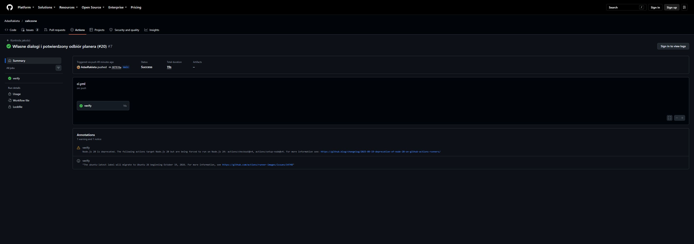
Rys. 7. Poprawnie zakończona kontrola jakości w GitHub Actions

Raport kontroli technicznej z 24.10.2026: 11 testów poprawnych, 0 niepowodzeń, cztery pliki testowe i poprawny build. CI używa Node.js 22; interfejs sprawdzono także w Chrome na Windows.

### Bug Tracking i checklista jakościowa

GitHub Issues jest rejestrem błędów. Zgłoszenie opisuje kroki odtworzenia, oczekiwany i rzeczywisty wynik, środowisko oraz wpływ na użytkownika. Priorytet P0 dotyczy utraty danych lub blokady głównego przepływu; P1 istotnej niewygody; P2 drobnej poprawki. PR łączy naprawę ze zgłoszeniem, a zamknięcie następuje po ponownym sprawdzeniu.

| Przykład | Odtworzenie i rezultat | Naprawa |
| --- | --- | --- |
| B-01 Ochrona planu | Wczytanie demo na własnych danych zastępowało plan bez pytania | Własne potwierdzenie i test anulowania |
| B-02 Licznik dni | 24 X termin 26 X był wskazywany jako za trzy dni | Obliczenia na datach kalendarzowych i test regresji |
| B-03 Klawiatura | Tab wychodził poza okno, a Escape nie zamykał formularza | Wspólny Modal i test powrotu fokusu |

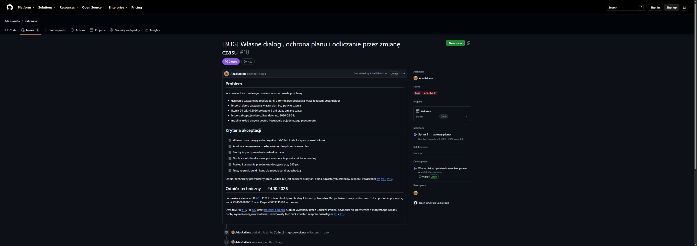
Rys. 8. Fragment zgłoszenia 18 z opisem problemów i kryteriami odbioru

### Checklista przed zakończeniem przyrostu

- [x] Testy 11/11 i kompilacja produkcyjna zakończone poprawnie.
- [x] Dodawanie, filtr, postęp oraz zapis po ponownym otwarciu sprawdzone.
- [x] Błędna kopia nie zmienia danych; anulowanie operacji zachowuje plan.
- [x] Własne potwierdzenia, Tab i Escape oraz widok mobilny sprawdzone.
- [x] Instrukcja odpowiada aplikacji, a PR zawiera sposób sprawdzenia.
- [x] Kopia JSON pobrana, strona i zasoby Pages ładują się poprawnie.

Emil prowadzi odbiór i odtwarza zgłoszenia; właściciel funkcji odpowiada za poprawkę. Jeśli błąd zmienia zakres sprintu, Jarek odnotowuje to na tablicy, a Iwona decyduje o priorytecie względem pozostałych potrzeb.

## 7. Zarządzanie ryzykiem

### Analiza SWOT projektu

| Mocne strony | Słabe strony |
| --- | --- |
| Mały, zrozumiały zakres; brak kosztu backendu; lokalne dane; szybkie wejście bez konta; własny i spójny interfejs. | Brak synchronizacji i współdzielenia; zależność od przeglądarki; brak powiadomień; konieczność samodzielnego wykonywania kopii. |
| Szanse | Zagrożenia |
| Plan tygodnia, eksport kalendarza, przypomnienia i rozszerzenie na inne kierunki po zebraniu potrzeb. | Wyczyszczenie pamięci, rozrost zakresu, niedostępność hostingu i przeciążenie osoby odpowiedzialnej za wdrożenie. |

### Plan zarządzania ryzykiem

| Ryzyko | P × W | Działanie i właściciel |
| --- | --- | --- |
| R-01 Utrata danych lokalnych | 3 × 3 = 9 | Widoczny eksport, ostrzeżenie przed usunięciem; Szymon |
| R-02 Niepoprawny import | 2 × 3 = 6 | Walidacja całości i regresje; Emil |
| R-03 Za szeroki zakres | 3 × 2 = 6 | Ochrona MVP i odkładanie integracji; Iwona |
| R-04 Opóźniony przegląd | 2 × 2 = 4 | WIP oraz pomoc w domykaniu rozpoczętych zadań; Jarek |
| R-05 Błąd ścieżki Pages | 2 × 3 = 6 | Build, kontrola /zaliczone/ i zasobów po publikacji; Szymon |
| R-06 Błąd na małym ekranie | 2 × 2 = 4 | Odbiór 360–390 px i klawiatury; Emil i Iwona |
| R-07 Nierówny podział wiedzy | 2 × 2 = 4 | Przeglądy między rolami i wspólne notatki; Jarek |

Prawdopodobieństwo i wpływ oceniamy w skali 1–3. Wynik 6 lub 9 wymaga działania w bieżącej iteracji. Ryzyka omawiamy na planowaniu i przeglądzie, a nową blokadę zapisujemy od razu w Issue. Gdy ryzyko się materializuje, otrzymuje właściciela i kryterium zamknięcia zamiast pozostawać ogólną uwagą.

## 8. Dokumentacja użytkowa

### Instrukcja obsługi i pierwszy plan

Po otwarciu aplikacji wybierz Dodaj przedmiot i wpisz nazwę. Następnie dodaj termin, wybierz przedmiot, datę oraz rodzaj zaliczenia. Dodaj kilka krótkich zadań przygotowawczych z datami. Kliknięcie pola przy wykonanym kroku zmienia jego status i aktualizuje procent postępu. Filtr nad planem ogranicza listę do wybranego przedmiotu.

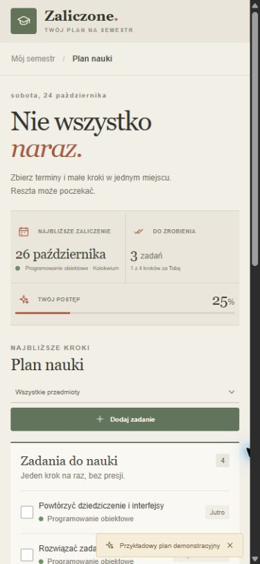
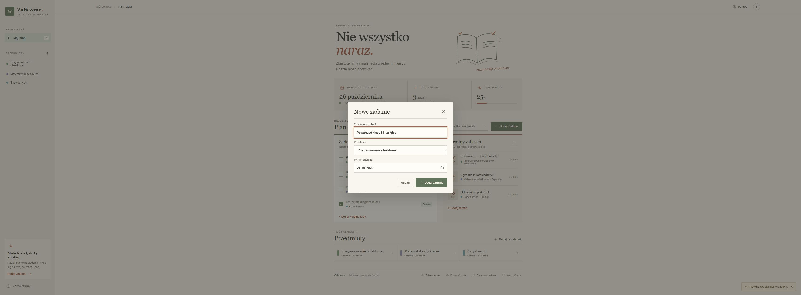
Rys. 9. Układ mobilny oraz własny formularz dodawania zadania

Na telefonie postęp znajduje się pod dwiema głównymi informacjami, a przycisk dodawania zadania ma szerokość listy. Kosz obok karty przedmiotu otwiera potwierdzenie usunięcia. W oknach Tab i Shift+Tab przechodzą między polami, Escape anuluje, a po zamknięciu fokus wraca do przycisku wywołującego.

### Kopia danych i FAQ

### Eksport i przywracanie planu

Pobierz kopię tworzy plik zaliczone-kopia.json. Zachowaj go przed czyszczeniem danych przeglądarki lub zmianą urządzenia. Na drugim urządzeniu otwórz aplikację, wybierz Przywróć kopię i wskaż plik. Jeśli istnieje już plan, zatwierdź zastąpienie dopiero po zabezpieczeniu własnych wpisów. Błędny plik wywoła komunikat bez zmiany bieżących danych.

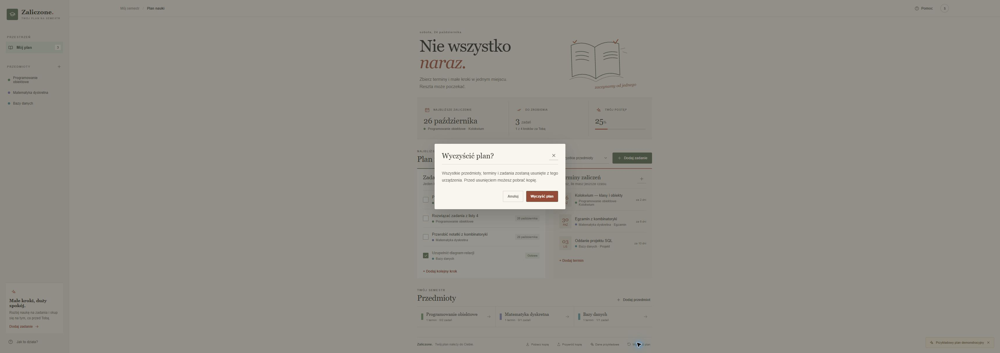
Rys. 10. Własne potwierdzenie chroniące przed przypadkowym usunięciem planu

### Najczęstsze pytania

Czy potrzebuję konta? Nie. Plan jest zapisywany w tej przeglądarce na tym urządzeniu. Czy działa synchronizacja? Nie automatycznie; do przeniesienia danych służy kopia JSON. Czy zamknięcie strony usuwa wpisy? Nie, o ile przeglądarka zachowuje localStorage i użytkownik nie wyczyści jej danych.

Co robią Dane przykładowe? Wczytują demonstracyjny semestr i zastępują bieżący plan po potwierdzeniu. Jak usunąć przedmiot? Wybierz jego kosz i potwierdź; usuwane są także powiązane terminy i zadania. Czy można dodać inny rodzaj zaliczenia? W MVP dostępne są Egzamin, Kolokwium i Projekt.

Dlaczego procent postępu nie jest oceną z przedmiotu? Wskaźnik pokazuje udział wykonanych zadań w całym planie. Terminy zaliczeń i oceny nie są z nim utożsamiane. Czy dane trafiają do GitHub? Nie; GitHub Pages udostępnia pliki aplikacji, a wpisy planera pozostają lokalne.

## 9. Retrospektywa projektu

Poniższe notatki, wypowiedzi i feedback są opracowaną symulacją dydaktyczną dwóch sprintów. Pokazują pracę czterech ról, zgłaszane trudności oraz konkretne ustalenia. Zapis jest skrócony do informacji potrzebnych do prowadzenia projektu.

#### Sprint 1  Planowanie  26.10.2026  18.00

- **Iwona:** Najpierw student musi dodać przedmiot, termin i mały krok do nauki.
- **Jarek:** Przyjmijmy cel działającego rdzenia i ograniczmy jednoczesną pracę do czterech zadań.
- **Szymon:** Ujednolicę model danych przed podłączeniem formularzy i zapisu w przeglądarce.
- **Emil:** Dopiszę przypadki pustych pól, błędnych relacji i zmiany procentu postępu.

**Ustalenie:** Przyjęto 27 SP. Iwona doprecyzowuje kryteria, Jarek koordynuje kolejność, Szymon model, Emil odbiór.

#### Sprint 1  Daily Scrum  28.10.2026  20.00

- **Szymon:** Zapis działa; potrzebuję wspólnej nazwy subjectId w zadaniach i terminach.
- **Iwona:** Formularze są czytelne, ale pusty plan powinien prowadzić najpierw do przedmiotu.
- **Jarek:** Terminy są posortowane; połączę filtr obu list po ustaleniu identyfikatora.
- **Emil:** Postęp liczy się poprawnie; sprawdzę jeszcze powrót po odświeżeniu strony.

**Ustalenie:** Ujednolicono subjectId. Nie rozpoczynamy kolejnej funkcji przed połączeniem filtra i zapisu.

#### Sprint 1  Przegląd  01.11.2026  18.30

- **Iwona:** Da się zaplanować przykładowe zaliczenie; brakuje jeszcze wyjaśnienia lokalnego przechowywania.
- **Jarek:** Cel sprintu osiągnięty; eksport i układ mobilny przechodzą do kolejnej iteracji.
- **Szymon:** Model nie wymaga zmiany do kopii JSON, wystarczy osobna walidacja importu.
- **Emil:** Podstawowe ścieżki przechodzą; odbiór kopii oraz klawiatury planuję na drugi sprint.

**Ustalenie:** Przyjęto rdzeń MVP. Do backlogu dopisano pomoc dotyczącą danych i ochronę odtwarzania.

#### Sprint 1  Retrospektywa 4Ls  01.11.2026  19.00

- **Szymon:** Pomogły małe zadania; następnym razem wcześniej uzgodnijmy format danych.
- **Iwona:** Dobre były krótkie formularze; chcę mniej ogólnych, a więcej mierzalnych kryteriów.
- **Jarek:** Tablica ujawniła zależności; powinniśmy wcześniej kończyć zadania czekające na odbiór.
- **Emil:** Zabrakło scenariusza błędnego pliku; dodam go przed implementacją importu.

**Ustalenie:** Sprint 2: widoczna informacja o danych, bezpieczny import i wcześniejsze kryteria testowe.

### Notatki Sprintu 2 i działania usprawniające

#### Sprint 2  Planowanie  02.11.2026  18.00

- **Iwona:** Kończymy kopię, telefon i pomoc; odłóżmy synchronizację oraz nowe rodzaje widoków.
- **Jarek:** Mamy 19 SP; zostawmy końcówkę iteracji na wspólną demonstrację i poprawki.
- **Szymon:** Import sprawdzi cały plik przed zapisem, a publikacja przejdzie przez PR.
- **Emil:** Odbiór obejmie anulowanie zmian, błędny JSON, klawiaturę i mały ekran.

**Ustalenie:** Zakres zamknięto do pięciu User Stories. Każda osoba przegląda element z innego obszaru.

#### Sprint 2  Daily Scrum  04.11.2026  20.00

- **Emil:** Licznik zawyża dni przy zmianie czasu; dopisałem dokładne kroki odtworzenia.
- **Szymon:** Poprawię obliczenia kalendarzowe i dodam regresję przed scaleniem kopii.
- **Iwona:** Na telefonie potrzebujemy widocznego postępu i przycisku usuwania obok przedmiotu.
- **Jarek:** Wstrzymujemy nową pracę, dopóki nie zamkniemy dwóch usterek blokujących odbiór.

**Ustalenie:** Błędy otrzymały właścicieli i kryteria. Odbiór poprawki dat wykonuje Emil, mobilnego widoku Iwona.

#### Sprint 2  Przegląd  08.11.2026  18.30

- **Szymon:** Kopia i publikacja działają; main jest chroniony, a zmiany przechodzą kontrolę CI.
- **Iwona:** Interfejs jest spójny, a przykład pozwala poznać aplikację bez wpisywania semestru.
- **Jarek:** Cel iteracji zrealizowany; instrukcja i tablica opisują ten sam zakres.
- **Emil:** Testy przechodzą, anulowanie zachowuje dane, a fokus wraca po zamknięciu formularza.

**Ustalenie:** Przyjęto MVP. Zapisano wersję, kopię demonstracyjną, wyniki kontroli i pakiet sprawozdania.

#### Sprint 2  Retrospektywa 4Ls  08.11.2026  19.00

- **Iwona:** Własne komponenty ułatwiły spójność; wcześniej pokażmy projekt widoku na telefonie.
- **Jarek:** WIP pomógł dokończyć odbiór; utrzymajmy przegląd krótkich zadań w połowie sprintu.
- **Szymon:** Test regresji szybko potwierdził naprawę; przegląd modelu powinien poprzedzać nowe formularze.
- **Emil:** Wcześniejsze scenariusze zadziałały; kolejne funkcje powinny zaczynać się od ryzyka utraty danych.

**Ustalenie:** Dalej stosujemy małe PR, wspólny odbiór mobilny i gotowe kryteria przed implementacją.

Raport iteracji: zakres 19 SP zakończono w scenariuszu ćwiczenia. Najważniejszą zmianą procesu było domykanie błędów przed rozpoczęciem nowej pracy oraz sprawdzanie kopii i klawiatury jako części zwykłego odbioru.

### Feedback 360 stopni i podsumowanie retrospektyw

Feedback w scenariuszu dotyczy zachowań przy pracy, ich wpływu i konkretnego następnego kroku. Każda osoba otrzymuje informację od innej roli; uzupełnieniem jest perspektywa studenta korzystającego z demonstracji. Ocena nie jest rankingiem osób.

| Odbiorca i autor | Obserwacja | Ustalone działanie |
| --- | --- | --- |
| Szymon Emil | Spójny model ułatwił regresje; import wymagał wcześniejszego omówienia błędnych danych. | Przed kolejną funkcją uzgodnić z testerem skrajne przypadki. |
| Iwona Jarek | Priorytety chroniły MVP; część kryteriów początkowo była zbyt ogólna. | Każda User Story otrzymuje przykład pozytywny i negatywny. |
| Jarek Iwona | Cele sprintów były jasne; odbiór gromadził się pod koniec pierwszej iteracji. | Przegląd rozpoczętych zadań w połowie sprintu i pilnowanie WIP. |
| Emil Szymon | Dokładne odtworzenie błędu czasu skróciło poprawkę; scenariusze warto tworzyć wcześniej. | Przypadki testowe powstają przed formularzem lub importem. |
| Zespół Student testujący | Podział na kroki i filtr pomagają; lokalny zapis wymaga wyjaśnienia. | Zachować widoczny eksport oraz krótką pomoc przy pierwszym użyciu. |

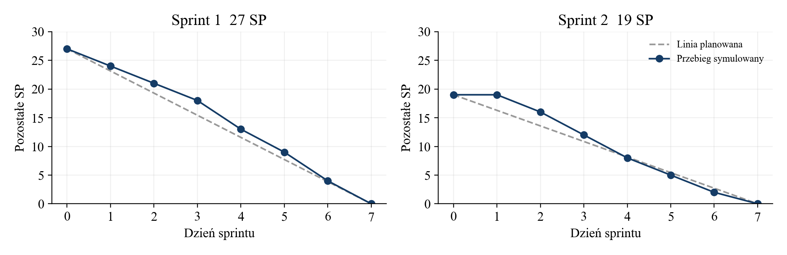
Rys. 11. Symulacja spalania punktów w dwóch sprintach

Pierwszy sprint nauczył zespół ustalać wspólny model i kryteria przed łączeniem funkcji. Drugi sprawdził te ustalenia w imporcie oraz poprawkach. Działania z retrospektyw mają właścicieli i są sprawdzane w kolejnej iteracji, dzięki czemu notatka kończy się zmianą sposobu pracy.

## 10. Wnioski i rekomendacje

### Ocena realizacji projektu

Projekt osiąga cel MVP: student może uporządkować semestr, zapisać terminy, zaplanować zadania i śledzić wykonanie. Zapis lokalny umożliwia korzystanie bez konta, a kopia JSON ogranicza ryzyko związane z danymi przeglądarki. Własne potwierdzenia, obsługa klawiatury i mobilny układ domykają podstawowy przepływ użytkownika.

Cztery role obejmują produkt i wygląd Iwony, organizację oraz funkcje Jarka, model i publikację Szymona oraz jakość Emila. W scenariuszu dwóch iteracji przyjęto 46 SP. Wyniki techniczne oraz symulowane notatki opisano oddzielnie.

### Propozycje dalszego rozwoju aplikacji

| Kolejność | Rozszerzenie | Warunek rozpoczęcia |
| --- | --- | --- |
| 1 | Eksport terminów do kalendarza | Potwierdzenie formatu i zasad aktualizacji wpisów |
| 2 | Plan tygodnia i edycja wpisów | Sprawdzenie potrzeb na większym semestrze |
| 3 | Przypomnienia | Uzgodnienie uprawnień i zachowania bez otwartej strony |
| 4 | Konto i synchronizacja | Osobny projekt backendu, bezpieczeństwa i ochrony danych |

### Rekomendacje dotyczące pracy zespołowej

Utrzymujemy małe zadania, jednego właściciela i mierzalny odbiór. Kończymy rozpoczętą pracę przed nową. Przeglądy między rolami rozkładają wiedzę w zespole. Każda zmiana przechodzi branch, PR, CI i kontrolę wdrożenia.

Retrospektywę kończymy działaniem i terminem sprawdzenia. Zmianę zakresu uzgadnia Product Owner; kopia danych i klawiatura pozostają stałą częścią odbioru.

### Adresy projektu i materiały

Aplikacja: https://adasrakieta.github.io/zaliczone/
Repozytorium: https://github.com/AdasRakieta/zaliczone
Tablica zespołu: https://github.com/users/AdasRakieta/projects/5/views/2
Kontrole jakości: https://github.com/AdasRakieta/zaliczone/actions
Wzór opracowania: dostarczony szablon UKW dla Laboratorium 10.
